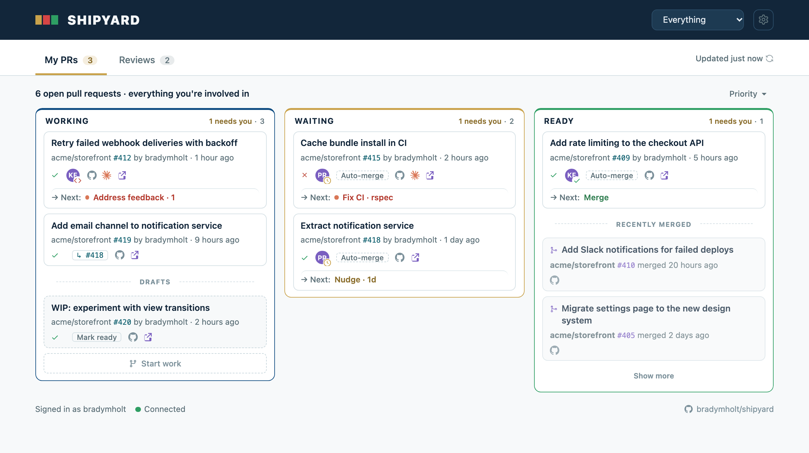
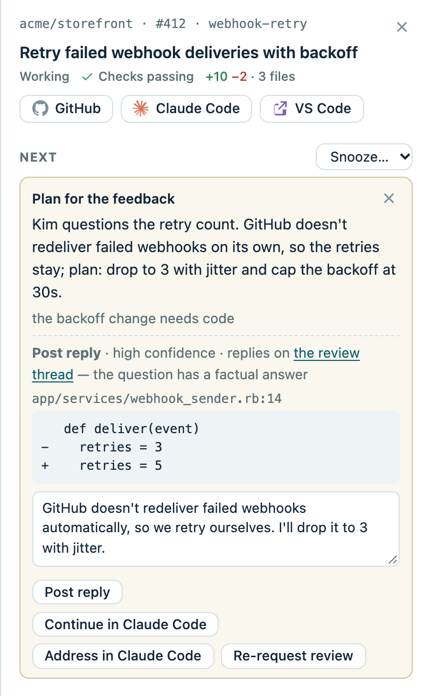
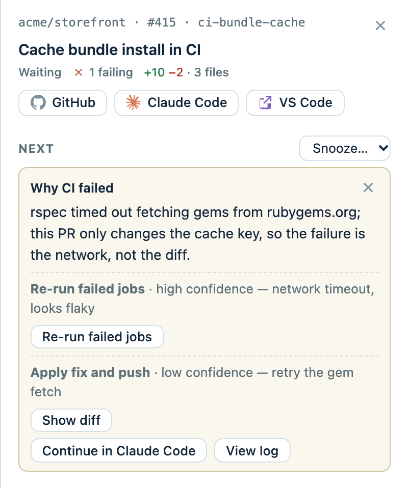
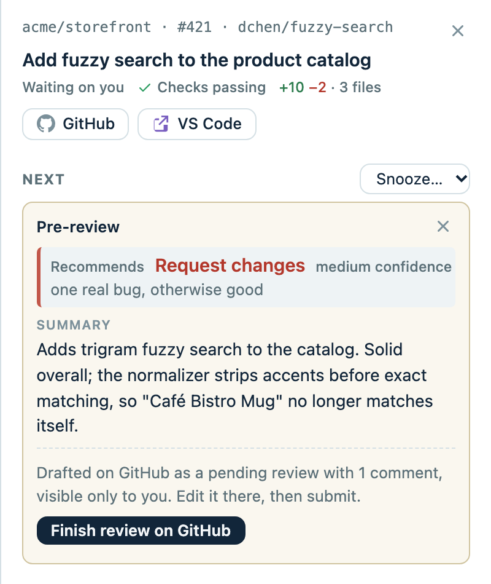
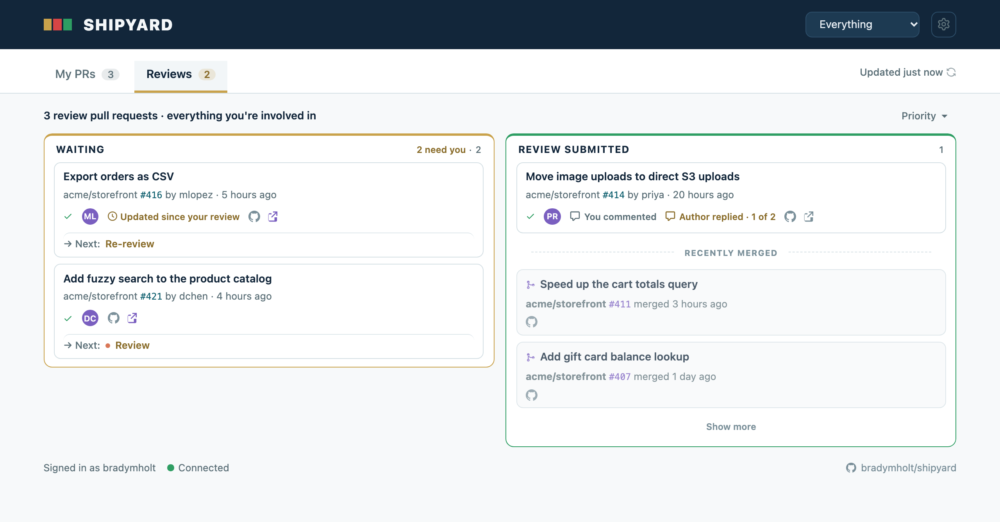

# Shipyard


<br/>

 &nbsp;**Would you take a quick second and ⭐️ my repo?**

<br/>

Shipyard is a local dashboard that watches your GitHub pull requests and has your coding agent help get them merged. It brings reviewer state, CI status, stacked PRs, and the work that needs your attention into one place.

When something happens to a PR (CI fails, your review is requested, a reviewer pushes back), Shipyard asks your coding agent (Claude Code or Codex) about it and turns the answer into a card with the buttons that fit: re-run the failed jobs, apply a fix, post a reply, approve. You decide; it prepares. Nothing posts under your name without showing you the text first.

Everything runs on your machine: a small local server serves the dashboard, makes the GitHub calls with your `gh` token, and matches PRs to your local clones so you can open them in your preferred app or IDE.

Want a simple hosted dashboard with nothing to run? See [Harbor](https://github.com/bradymholt/harbor).



### Your agent does the legwork

When something happens to a PR, Shipyard asks your coding agent about it and hands you a card with its take and the buttons that fit. You stay in charge: nothing posts under your name until you've seen the text.

<table>
  <tr>
    <th width="33%">A reviewer pushes back</th>
    <th width="33%">CI goes red</th>
    <th width="33%">Your review is requested</th>
  </tr>
  <tr>
    <td valign="top">The agent reads the thread in the session that wrote the PR, plans the change, and drafts your reply.</td>
    <td valign="top">It reads the failing job's log, tells flaky from real, and offers a re-run or a fix.</td>
    <td valign="top">It pre-reviews the PR and drafts a pending review on GitHub, visible only to you, for you to edit and submit.</td>
  </tr>
  <tr>
    <td valign="top"></td>
    <td valign="top"></td>
    <td valign="top"></td>
  </tr>
</table>

### Reviews you owe, in one place



## Quick start

```bash
git clone https://github.com/bradymholt/shipyard.git
cd shipyard
python3 shipyard.py ~/dev
```

Open http://localhost:4321: the board shows every PR you're involved in, and views can narrow it to a repository, organization, or username. `~/dev` is the folder that holds your Git clones, for opening checkouts and starting work; you can leave it off and add folders later in Settings. See [Running Shipyard](#running-shipyard) for configuration and running at login.

## GitHub access

Shipyard uses the [GitHub CLI](https://cli.github.com/)'s token: install `gh` and run `gh auth login`. The server reads it with `gh auth token` and makes every GitHub call itself, so the token never reaches the browser. Your views are saved in `shipyard.config.json` (as `"views"`), so every browser sees the same ones and you can edit them there too; display preferences stay in your browser's local storage.

## Features

- **Shipping orchestrator:** the server watches your PRs, asks your coding agent about the ones that changed, and shows its judgment as a card with the buttons that fit.
- **Action-focused views:** My PRs and Reviews, with priority, updated, and created sorting.
- **Board layout:** reviewer state, new commits since your review, drafts, approvals, and ready-to-merge work at a glance, with lanes that stack and collapse on a phone.
- **Useful context:** CI checks, labels, comments, stacked PR relationships, and your three most recently merged PRs.
- **Flexible scope:** combine repositories, organizations, and usernames, then filter across titles, authors, branches, and repositories.
- **PR actions:** toggle auto-merge and move drafts to ready without leaving the dashboard.
- **Next actions:** a **Next** row at the bottom of each card that has a next step (Address feedback, Fix CI, Merge, Review, Re-review), and a sidebar with the PR's timeline.
- **Local workflow:** open existing checkouts in your preferred app or IDE, or start a branch in the main clone or an isolated worktree.

## Running Shipyard

Shipyard runs `shipyard.py`, the server process that serves the dashboard, watches your PRs with your coding agent, opens checkouts in your preferred app or IDE, and adds branch/worktree actions. It requires Git, Python 3, and a signed-in [GitHub CLI](#github-access); start it as in [Quick start](#quick-start). Replace `~/dev` with a folder that directly contains your Git clones; you can pass more than one folder or use `--port` to choose another port. Without folders, Shipyard still runs and uses the ones set in Settings (Folders to scan), which apply without a restart.

On macOS, you can keep it running in the background instead. Copy the example config, set `roots` to your folders, and install it as a login agent:

```bash
cp shipyard.config.example.json shipyard.config.json
./shipyard-launchd.py install
```

See [Run at login (macOS)](#run-at-login-macos) for details.

The server matches GitHub PR branches to clones found under your configured folders. It binds to localhost and accepts branch actions only from the dashboard it serves.

Worktree discovery is read-only. Actions you choose can fetch, create, or switch local branches and create worktrees. Shipyard refuses to switch a main clone with tracked changes, opens an existing checkout when one already owns the branch, and never removes existing worktrees. New worktrees are created under `<repo>/.claude/worktrees/`.

For a persistent setup, copy the example configuration and adjust `roots`:

```bash
cp shipyard.config.example.json shipyard.config.json
python3 shipyard.py
```

```json
{
  "roots": ["~/dev"],
  "launcher": {
    "name": "VS Code",
    "mode": "url",
    "target": "workspace",
    "url": "vscode://file/{path}",
    "command": ["code", "{path}"]
  },
  "branchPrefix": ""
}
```

`app` picks a preset: `vscode` (the default), `cursor`, `windsurf`, or `zed`; it fills in the rest, and anything you set here overrides it. Opening by command needs the app's command-line tool on your PATH. The launcher is app-agnostic beyond the presets. URL mode opens a custom URL scheme in the browser; command mode asks the server to run a command. Use `{path}` where the checkout path belongs. `target` can be `folder`, or `workspace` to prefer a `.code-workspace` file when one exists.

For example, this opens the checkout folder in Xcode on macOS:

```json
{
  "launcher": {
    "name": "Xcode",
    "mode": "command",
    "target": "folder",
    "command": ["open", "-a", "Xcode", "{path}"]
  }
}
```

### Resume a coding agent

When a checkout has a recent coding-agent session, a second icon next to the open icon resumes the latest one. Claude Code is the default:

```json
{
  "agent": {
    "name": "Claude Code",
    "sessions": "claude-code",
    "mode": "url",
    "url": "claude://resume?session={session}",
    "command": ["open", "claude://resume?session={session}"],
    "prompt_url": "claude://code/new?folder={path}&q={prompt}"
  }
}
```

`sessions` picks where to look for transcripts: `claude-code` reads `~/.claude/projects/`, and `codex` reads `~/.codex/sessions/`. Each brings its own defaults for the other agent settings, so `"agent": {"sessions": "codex"}` alone is enough: Codex has no resume URL, so its default runs a command that opens Terminal in the checkout and runs `codex resume` there (macOS), and it has no `prompt_url`. The server matches sessions to checkouts by working directory and uses the most recently written one. `mode` works as it does for the launcher; `{session}` is the session id and `{path}` the checkout path. Set `"agent": null` to hide the icon. `prompt_url` opens a new session with `{prompt}` typed in, for the **Address** button on Address feedback; it defaults to `null` for Codex, where that button resumes the session instead.

`branchPrefix` optionally prefills new branch names.

### Next actions and the sidebar

Click a card (or its Next row) to open the sidebar: the PR's state and launch buttons, **Next**, **PR session**, and **Activity**. You also get:

- **Memory next steps:** `Nudge · 1d` when a reviewer has sat on it past a threshold, `Ask for re-review · 1d` when an author updated a PR you requested changes on but never asked you back, and snoozed cards that dim in place.
- **Passes:** when something happens to a PR (CI failed, your review requested or re-requested, and changes requested if you turn that pass on), the server asks your coding agent about it and turns the answer into a Next card: a short judgment and the buttons that fit it. On your PRs it asks the session that opened the PR, so earlier decisions are in context: a fork for questions (nothing is written back) and a resume for a plan you'll continue. For someone else's PR it runs a pre-review in a review worktree at the PR's head (`<repo>/.claude/worktrees/review-<n>`). The pre-review's comments go up as a pending review, which only you can see until you edit and submit it on GitHub; an approval with no comments stays an Approve button instead, with its note editable on the card. It never adds a turn to a session that is open right now; the card gives you the event to paste instead.
- **Buttons:** Continue in your agent, Re-run failed jobs, Post reply, Submit as review, Re-request review, Merge, and so on. Anything that posts under your name shows the full, editable text first, and Apply fix shows the diff first. An **Ask** field puts one question to the PR's session (as a fork).
- **PR session:** the pinned session (the one whose transcript ran `gh pr create` for the PR), whether it's active, turns yours vs Shipyard's, the last exchange, and Re-pin.

Passes run your agent's CLI (`claude`, or `codex` with `"sessions": "codex"`) headlessly with read-only tools, on your existing subscription. State lives in `shipyard.db` next to the config.

#### Rule and trust settings

What each rule does is code; when it fires, and whether it fires at all, is config:

```json
{
  "rules": {
    "nudge":       { "after_hours": 24 },
    "merge":       true,
    "address_feedback": { "prompt": "/pr-review-respond {url} (branch {branch})" },
    "passes": { "feedback": false, "ci_failed": "auto", "pre_review": "auto", "re_review": "ask" },
    "instructions": { "ci_failed": "Specs under spec/system are often flaky; prefer a re-run there." }
  },
  "auto": {
    "rerun_checks": { "when": "confidence >= high", "max_per_pr": 2 }
  }
}
```

Set a rule to `false` to drop its next step and pass (`address_feedback`, `fix_ci`, `merge`, `review`, `re_review`, `nudge`, `rerequest_review`). A pass set to `"ask"` waits for **Ask** in the sidebar instead of running on its own. Address feedback runs no pass by default: its card's **Address** button opens a new session with the rule's `prompt` (`{url}`, `{repo}`, `{number}`, `{branch}`; default `Address the review feedback on {url} (branch {branch})`), so a skill of yours can take it from there. The session starts from the repository, not the PR's checkout, so the prompt names the branch to work on. Set `"feedback": "auto"` to have the agent draft a plan and replies on the card as well. `instructions` adds your own text to a pass's prompt (`feedback`, `ci_failed`, `pre_review`, `re_review`), ahead of the answer format Shipyard reads back.

On a new install, a short welcome says what Shipyard does, suggests views and the folder your code is in, and asks before Shipyard acts on its own. Until you turn that on there or in Settings, passes wait for Ask and nothing is pressed for you; an install that has polled before keeps going as configured. `auto` is the trust ladder. Every action type but `approve_rereview` and `rerun_checks` starts manual; turn one on here to let the server press its button when the agent is confident. Handled cards offer Undo where there is one. Trustable: `rerun_checks`, `approve_rereview`, `apply_fix`. `post_reply` is locked, and submitting a review is never automatic: both put words in front of a colleague under your name. An automatic action only fires on its own kind of pass (re-running checks from a CI pass on your PR, approving from a re-review of someone else's), only while the card's PR is still open at the same head, and an automatic approval never carries text. `approve_rereview` is on by default and is the master switch for a per-PR Auto-approve checkbox in the sidebar of each PR you review. The pre-review sets the checkbox: on when what it asks for is small and checkable from the diff, whatever the verdict, so a Request changes review can be approved once the push addresses it. Your own click wins over the pre-review. With no pre-review, it starts on only when your last review was an approval (one dismissed by a new push still counts). `approve_rereview` takes `max_lines` (default 30): it approves only when the change since your last review touches at most that many lines (additions + deletions) and adds no files, per GitHub's compare API; otherwise, or when the size can't be told, the card stays a button and says why. It also takes `min_wait_minutes` (default 3): an automatic approval waits until at least that long after the server first saw the push, so it never lands seconds after the author's commit. The re-review pass diffs from your last reviewed commit and lowers its confidence when anything goes beyond your threads. `rerun_checks` is on by default (high confidence, at most 2 per PR); set it to `false` to keep re-runs manual. An automatic `rerun_checks` waits while other checks on the PR are still running, then re-runs the failed jobs once they finish, unless more checks failed in the meantime. `apply_fix` takes `max_lines` (default 20): it pushes the agent's diff only when it changes at most that many lines, adds no files, and edits only files the PR already changes. Whenever an automatic action holds back, its card says why. Apart from that checkbox, settings change in this file or in the settings page (⚙, at `#settings`), never from a card; the server picks up a hand edit within a minute. The page shows each setting's default and which ones the file changes, with a Reset that takes a setting back out of the file. `post_reply` stays locked there too.

Passes on someone else's PR run in its review worktree with only your user-level agent settings, so a PR can't bring its own hooks or permission rules along.

### Run at login (macOS)

<details>
<summary>Keep the server always running with a <code>launchd</code> agent</summary>

`shipyard-launchd.py` runs the server as a `launchd` user agent, so it starts at login and comes back if it exits.

```bash
./shipyard-launchd.py install
```

That installs two agents, using absolute paths taken from this checkout: `local.shipyard` runs the server, and `local.shipyard-restart` watches `shipyard.py` and the `shipyard/` package to restart it when you save. The server picks up edits to `shipyard.config.json` itself within a minute (except `roots`, which needs a restart). `install` then confirms the server actually stayed running rather than crash-looping. Re-run it after moving the repo or upgrading Python.

```bash
./shipyard-launchd.py status     # state, pid, restart count, log sizes
./shipyard-launchd.py restart
./shipyard-launchd.py logs -f
./shipyard-launchd.py uninstall
```

Output goes to `~/Library/Logs/shipyard.out.log` and `shipyard.err.log`. The plists are ordinary launchd agents, so read or tweak them directly if you want different settings. Saving a plist is not enough on its own, though: launchd only picks up changes at login or through `install`.

If a plist in `~/Library/LaunchAgents` is a symlink, something else already owns it (a dotfiles repo, say). `install` leaves those files alone and just loads them, so it stays useful for starting agents your own setup only symlinked into place, and `uninstall` stops them without deleting anything it did not write.

</details>

## Development

There is no build step or dependency installation. Run `python3 shipyard.py ~/dev` and reload the page after editing `index.html`, `app.css`, or `js/`. Issues and pull requests are welcome.

```bash
python3 -m unittest discover tests     # server: events, rules, passes, actions, git, HTTP
node tests/ui/smoke.mjs                # browser: Next rows and sidebar against fake data (needs Playwright)
python3 tests/ui/demo_server.py 4399   # the server over fake GitHub and agent data
node tests/ui/readme_shots.mjs         # regenerate the README screenshots in docs/
```

## License

Shipyard is available under the [MIT License](LICENSE).
