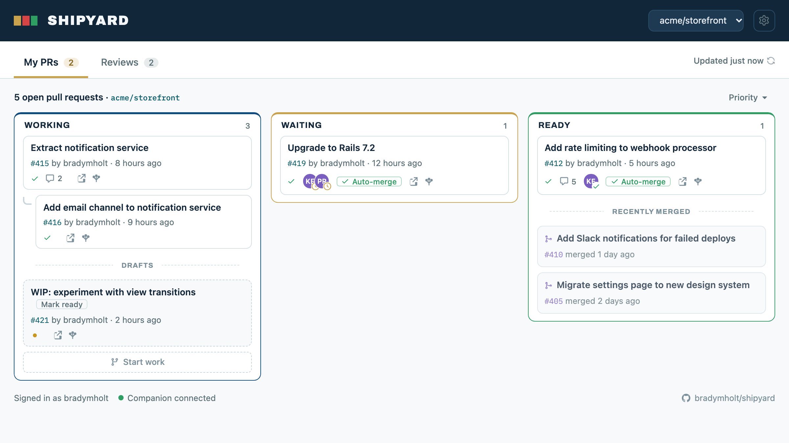
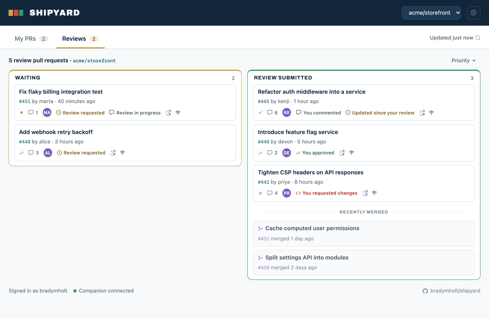

# Shipyard


<br/>

 &nbsp;**Would you take a quick second and ⭐️ my repo?**

<br/>

Shipyard is a focused dashboard for staying on top of GitHub pull requests. It brings reviewer state, CI status, stacked PRs, and the work that needs your attention into one place. Use it directly from GitHub Pages, or run it locally to connect PRs to local branches and open them in your preferred app or IDE.

## Quick start

**In your browser:** open the [hosted dashboard](https://bradymholt.github.io/shipyard/), add a [GitHub token](#github-token) (saved only in your browser's local storage), then add a repository, organization, or username to your views. Nothing needs to be installed.

On Android, open the menu in Chrome and choose **Install app** (or **Add to Home screen**) to run Shipyard as a standalone app. Safari on iOS offers the same through **Share → Add to Home Screen**.

**Locally:** run Shipyard on your machine to match PRs to your local clones, open them in your preferred app or IDE, and start branches or worktrees. See [Local mode](#local-mode) for setup.

## Screenshots

### Board view

See drafts, waiting work, approvals, and recent merges by stage.



### Review board

Track the PRs you owe a review, split into what's still waiting on you and what you've already reviewed, with counts and pending-review indicators.



## GitHub token

A fine-grained personal access token limited to the repositories you use is recommended. Pull requests read access is enough for viewing; write access is needed to toggle auto-merge or mark a draft ready for review. A classic token needs the `repo` scope for private repositories.

Your token and recent dashboard data stay in your browser's local storage. The token is sent only to `api.github.com`. The hosted and local versions use separate browser storage, so each needs to be configured once.

## Features

- **Action-focused views:** My PRs and Reviews, with priority, updated, and created sorting.
- **Board layout:** reviewer state, new commits since your review, drafts, approvals, and ready-to-merge work at a glance, with lanes that stack and collapse on a phone.
- **Useful context:** CI checks, labels, comments, stacked PR relationships, and your three most recently merged PRs.
- **Flexible scope:** combine repositories, organizations, and usernames, then filter across titles, authors, branches, and repositories.
- **PR actions:** toggle auto-merge and move drafts to ready without leaving the dashboard.
- **Next actions:** a chip on each card that has a next step (Address feedback, Fix CI, Merge, Review, Re-review), and a sidebar with the PR's timeline.
- **Shipping orchestrator (local):** the companion watches your PRs, asks your coding agent about the ones that changed, and shows its judgment as a card with the buttons that fit. You decide; it prepares.
- **Optional local workflow:** open existing checkouts in your preferred app or IDE, or start a branch in the main clone or an isolated worktree.

## Local mode

Local mode runs `shipyard.py`, an optional companion process that serves the dashboard, opens checkouts in your preferred app or IDE, and adds branch/worktree actions. It requires Git and Python 3.

```bash
git clone https://github.com/bradymholt/shipyard.git
cd shipyard
python3 shipyard.py ~/dev
```

Then open http://localhost:4321. Replace `~/dev` with a folder that directly contains your Git clones; you can pass more than one folder or use `--port` to choose another port.

On macOS, you can keep it running in the background instead. Copy the example config, set `roots` to your folders, and install it as a login agent:

```bash
cp shipyard.config.example.json shipyard.config.json
./shipyard-launchd.py install
```

See [Run at login (macOS)](#run-at-login-macos) for details.

The companion matches GitHub PR branches to clones found under your configured folders. It binds to localhost and accepts branch actions only from the dashboard it serves.

Worktree discovery is read-only. Actions you choose can fetch, create, or switch local branches and create worktrees. Shipyard refuses to switch a main clone with tracked changes, opens an existing checkout when one already owns the branch, and never removes existing worktrees. New worktrees are created under `<repo>/.claude/worktrees/`.

For a persistent setup, copy the example configuration and adjust `roots`:

```bash
cp shipyard.config.example.json shipyard.config.json
python3 shipyard.py
```

```json
{
  "roots": ["~/dev"],
  "launcher": {
    "name": "VS Code",
    "mode": "url",
    "target": "workspace",
    "url": "vscode://file/{path}",
    "command": ["code", "{path}"]
  },
  "branchPrefix": ""
}
```

VS Code is the default, but the launcher is app-agnostic. URL mode opens a custom URL scheme in the browser; command mode asks the companion to run a command. Use `{path}` where the checkout path belongs. `target` can be `folder`, or `workspace` to prefer a `.code-workspace` file when one exists.

For example, this opens the checkout folder in Xcode on macOS:

```json
{
  "launcher": {
    "name": "Xcode",
    "mode": "command",
    "target": "folder",
    "command": ["open", "-a", "Xcode", "{path}"]
  }
}
```

### Resume a coding agent

When a checkout has a recent coding-agent session, a second icon next to the open icon resumes the latest one. Claude Code is the default:

```json
{
  "agent": {
    "name": "Claude Code",
    "sessions": "claude-code",
    "mode": "url",
    "url": "claude://resume?session={session}",
    "command": ["open", "claude://resume?session={session}"]
  }
}
```

`sessions` picks where to look for transcripts: `claude-code` reads `~/.claude/projects/`, and `codex` reads `~/.codex/sessions/`. The companion matches sessions to checkouts by working directory and uses the most recently written one. `mode` works as it does for the launcher; `{session}` is the session id and `{path}` the checkout path. Set `"agent": null` to hide the icon.

`branchPrefix` optionally prefills new branch names.

### Next actions and the sidebar

Click a card (or its chip) to open the sidebar: the PR's state and launch buttons, **Next**, **PR session**, **Review** (reviewers, comment counts, files), and **Activity**. Hosted, you get the chips that come straight from GitHub data and the Header, Review, and Activity sections. With the companion running you also get:

- **Memory chips:** `Nudge · 26h` when a reviewer has sat on it past a threshold, and snoozed cards that dim in place.
- **Passes:** when something happens to a PR (changes requested, CI failed, your review requested or re-requested), the companion asks your coding agent about it and turns the answer into a Next card: a short judgment and the buttons that fit it. On your PRs it asks the session that opened the PR, so earlier decisions are in context: a fork for questions (nothing is written back) and a resume for a plan you'll continue. For someone else's PR it runs a pre-review in a review worktree at the PR's head (`<repo>/.claude/worktrees/review-<n>`). It never adds a turn to a session that is open right now; the card gives you the event to paste instead.
- **Buttons:** Continue in your agent, Re-run checks, Post reply, Submit as review, Re-request review, Merge, and so on. Anything that posts under your name shows the full, editable text first, and Apply fix shows the diff first. An **Ask** field puts one question to the PR's session (as a fork).
- **PR session:** the pinned session (the one whose transcript ran `gh pr create` for the PR), whether it's active, turns yours vs Shipyard's, the last exchange, and Re-pin.
- **Clean up worktree** on merged cards whose worktree lives under `.claude/worktrees/`. It refuses a worktree with uncommitted or untracked files, and deletes the branch only when it is merged.

The companion reads its GitHub token from `gh auth token` (install the [GitHub CLI](https://cli.github.com/) and run `gh auth login`); the page's token stays in the browser. Passes run your agent's CLI (`claude`, or `codex` with `"sessions": "codex"`) headlessly with read-only tools, on your existing subscription. State lives in `shipyard.db` next to the config. Run with `--no-orchestrator` to skip all of this and keep only the page and worktree links.

#### Rule and trust settings

What each rule does is code; when it fires, and whether it fires at all, is config:

```json
{
  "rules": {
    "nudge":       { "after_hours": 24 },
    "merge":       true,
    "passes": { "changes_requested": "auto", "ci_failed": "auto", "pre_review": "auto", "re_review": "ask" }
  },
  "auto": {
    "rerun_checks":      { "when": "confidence >= high", "max_per_pr": 2 },
    "cleanup_review_wt": true
  }
}
```

Set a rule to `false` to drop its chip and pass (`address_feedback`, `fix_ci`, `merge`, `review`, `re_review`, `nudge`, `rerequest_review`, `cleanup_worktree`). A pass set to `"ask"` waits for **Ask** in the sidebar instead of running on its own.

`auto` is the trust ladder. Every action type starts manual. Once you've pressed the same kind of button a few times, its card offers "Do this automatically when … is confident", which writes the entry for you; Handled cards offer Undo where there is one, and "Stop doing this automatically". Trustable: `rerun_checks`, `cleanup_review_wt`, `rerequest_review`, `enable_auto_merge`, `approve_rereview`, `apply_fix`. `post_reply` is locked, and submitting a review is never automatic: both put words in front of a colleague under your name. An automatic action only fires on its own kind of pass (re-running checks from a CI pass on your PR, approving from a re-review of someone else's), only while the card's PR is still open at the same head, and an automatic approval never carries text. Under `launchd`, saving the config restarts the companion; a pass cut short shows **Try again** rather than running twice.

Passes on someone else's PR run in its review worktree with only your user-level agent settings, so a PR can't bring its own hooks or permission rules along.

### Run at login (macOS)

<details>
<summary>Keep the companion always running with a <code>launchd</code> agent</summary>

`shipyard-launchd.py` runs the companion as a `launchd` user agent, so it starts at login and comes back if it exits.

```bash
./shipyard-launchd.py install
```

That installs two agents, using absolute paths taken from this checkout: `local.shipyard` runs the companion, and `local.shipyard-restart` watches `shipyard.py`, the `shipyard/` package, and `shipyard.config.json` to reload it when you save. `install` then confirms the companion actually stayed running rather than crash-looping. Re-run it after moving the repo, upgrading Python, or creating your config.

```bash
./shipyard-launchd.py status     # state, pid, restart count, log sizes
./shipyard-launchd.py restart
./shipyard-launchd.py logs -f
./shipyard-launchd.py uninstall
```

Output goes to `~/Library/Logs/shipyard.out.log` and `shipyard.err.log`. The plists are ordinary launchd agents, so read or tweak them directly if you want different settings. Saving a plist is not enough on its own, though: launchd only picks up changes at login or through `install`.

If a plist in `~/Library/LaunchAgents` is a symlink, something else already owns it (a dotfiles repo, say). `install` leaves those files alone and just loads them, so it stays useful for starting agents your own setup only symlinked into place, and `uninstall` stops them without deleting anything it did not write.

</details>

## Development

There is no build step or dependency installation. Serve `index.html` with `python3 -m http.server`, or run `python3 shipyard.py ~/dev` to exercise local mode. Issues and pull requests are welcome.

```bash
python3 -m unittest discover tests     # companion: events, rules, passes, actions, git, server
node tests/ui/smoke.mjs                # browser: chips and sidebar against fake data (needs Playwright)
python3 tests/ui/demo_server.py 4399   # the companion over fake GitHub and agent data
```

## License

Shipyard is available under the [MIT License](LICENSE).
