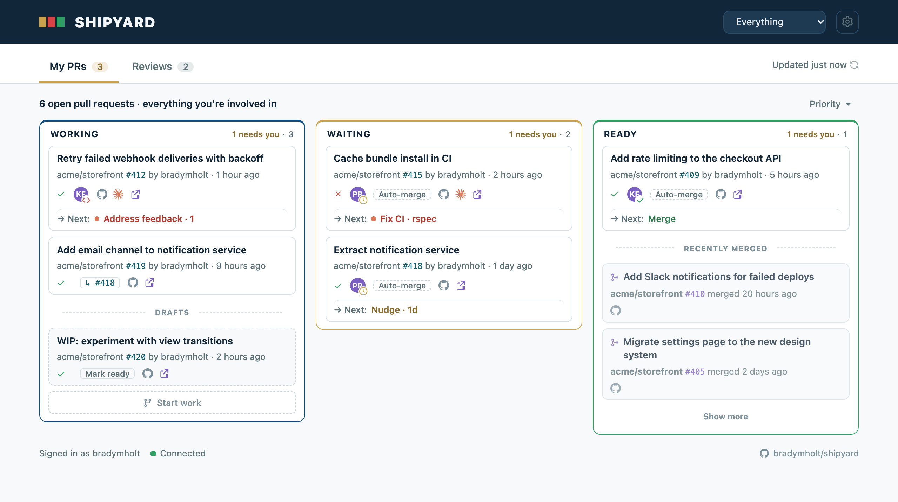
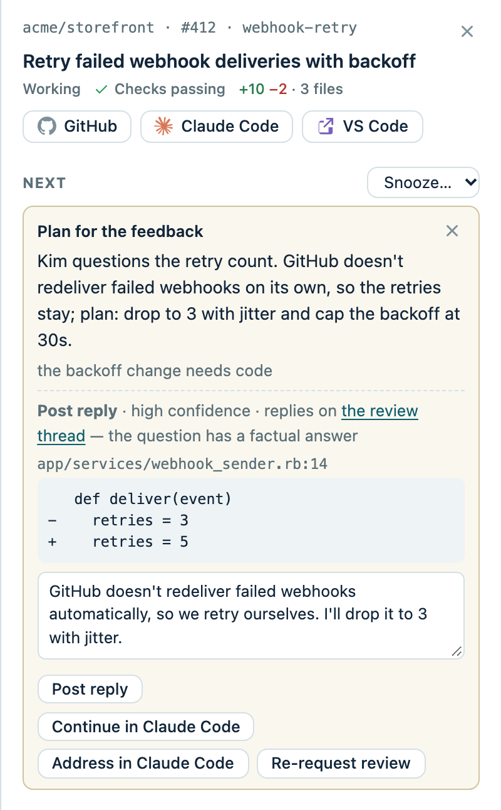
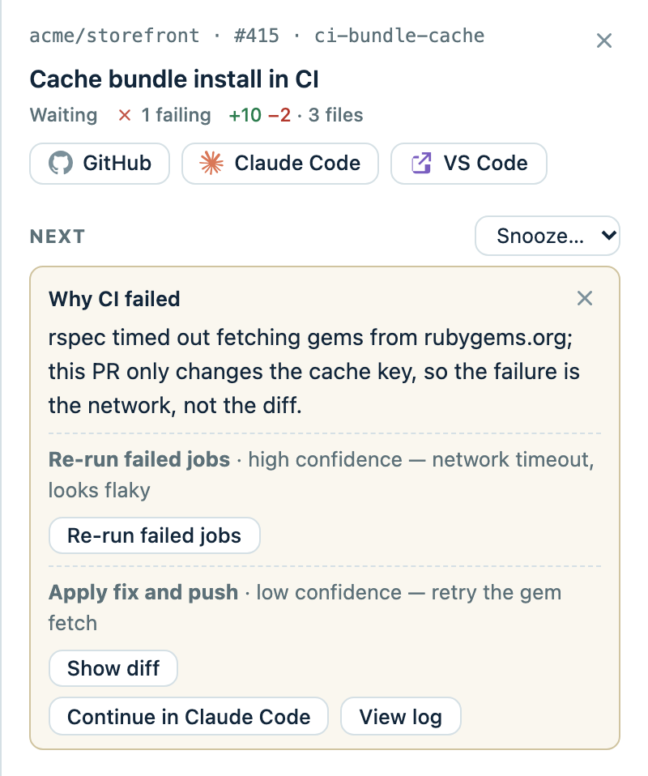
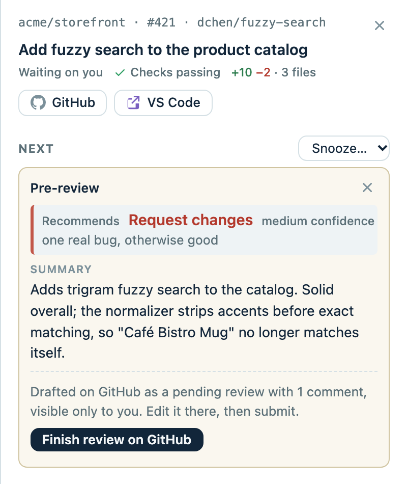
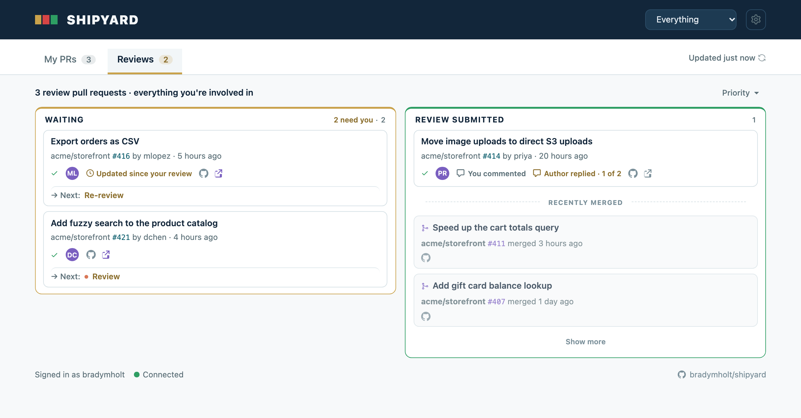

# Shipyard


<br/>

 &nbsp;**Would you take a quick second and ⭐️ my repo?**

<br/>

Shipyard is a local dashboard that watches your GitHub pull requests and has your coding agent help get them merged. It brings reviewer state, CI status, stacked PRs, and the work that needs your attention into one place.

Everything runs on your machine: a small local server serves the dashboard, makes the GitHub calls with your `gh` token, and matches PRs to your local clones so you can open them in your preferred app or IDE.

Want a simple hosted dashboard with nothing to run? See [Harbor](https://github.com/bradymholt/harbor).



### Your agent does the legwork

When something happens to a PR (CI fails, your review is requested, a reviewer pushes back), Shipyard asks your coding agent (Claude Code or Codex) about it and hands you a card with its take and the buttons that fit: re-run the failed jobs, apply a fix, post a reply, approve. You decide; it prepares. Nothing posts under your name without showing you the text first.

<table>
  <tr>
    <th width="33%">A reviewer pushes back</th>
    <th width="33%">CI goes red</th>
    <th width="33%">Your review is requested</th>
  </tr>
  <tr>
    <td valign="top">The agent reads the thread in the session that wrote the PR, plans the change, and drafts your reply.</td>
    <td valign="top">It reads the failing job's log, tells flaky from real, and offers a re-run or a fix.</td>
    <td valign="top">It pre-reviews the PR and drafts a pending review on GitHub, visible only to you, for you to edit and submit.</td>
  </tr>
  <tr>
    <td valign="top"></td>
    <td valign="top"></td>
    <td valign="top"></td>
  </tr>
</table>

### Reviews you owe, in one place



## Quick start

```bash
git clone https://github.com/bradymholt/shipyard.git
cd shipyard
python3 shipyard.py ~/dev
```

Open http://localhost:4321: the board shows every PR you're involved in, and views can narrow it to a repository, organization, or username. `~/dev` is the folder that holds your Git clones, for opening checkouts and starting work; you can leave it off and add folders later in Settings. See [Running Shipyard](#running-shipyard) for configuration and running at login.

## GitHub access

Shipyard uses the [GitHub CLI](https://cli.github.com/)'s token: install `gh` and run `gh auth login`. The server reads it with `gh auth token` and makes every GitHub call itself, so the token never reaches the browser.

## Features

- **Shipping orchestrator:** the server watches your PRs, asks your coding agent about the ones that changed, and shows its judgment as a card with the buttons that fit.
- **Action-focused views:** My PRs and Reviews, with priority, updated, and created sorting.
- **Board layout:** reviewer state, new commits since your review, drafts, approvals, and ready-to-merge work at a glance, with lanes that stack and collapse on a phone.
- **New since you looked:** a dot on each card updated since you last opened it.
- **Insights:** your review load, PRs merged per week, median time to merge, and open PR age, for the current view. Opening the tab reads the last 12 weeks of merges, cached for 15 minutes.
- **Useful context:** CI checks, labels, comments, stacked PR relationships, and your three most recently merged PRs.
- **Flexible scope:** combine repositories, organizations, and usernames, then filter across titles, authors, branches, and repositories.
- **PR actions:** toggle auto-merge and move drafts to ready without leaving the dashboard.
- **Next actions:** a **Next** row at the bottom of each card that has a next step (Address feedback, Resolve conflicts, Update from a stacked parent, Fix CI, Merge, Review, Re-review), and a sidebar with the PR's timeline.
- **Local workflow:** open existing checkouts in your preferred app or IDE, or start a branch in the main clone or an isolated worktree.

## Running Shipyard

`shipyard.py` is the whole thing: it serves the dashboard, watches your PRs with your coding agent, and opens or creates checkouts. It needs Git, Python 3, and a signed-in [GitHub CLI](#github-access).

```bash
python3 shipyard.py ~/dev ~/code --port 4321
```

Each folder should directly contain Git clones; the server matches PR branches to them. Without folders, Shipyard uses the ones set in Settings (Folders to scan), which apply without a restart. On macOS, you can [run it at login](#run-at-login-macos) instead.

Discovery is read-only. Actions you choose can fetch, create, or switch local branches and create worktrees (under `<repo>/.claude/worktrees/`). A pass on a repository with no clone under your folders runs in a clone Shipyard makes for itself under `~/.cache/shipyard/clones/`; a clone of yours is used whenever one exists. Shipyard refuses to switch a main clone with tracked changes, opens an existing checkout when one already owns the branch, and never removes a worktree. The server binds to localhost and accepts branch actions only from the dashboard it serves.

### Configuration

Settings live in `shipyard.config.json` next to `shipyard.py`. The settings page (⚙, at `#settings`) edits the same file: it shows each setting's default, marks the ones the file changes, and has a Reset that takes a setting back out. The server picks up a hand edit within a minute (`roots` needs a restart). Start from the example:

```bash
cp shipyard.config.example.json shipyard.config.json
```

```json
{
  "roots": ["~/dev"],
  "launcher": {
    "name": "VS Code",
    "mode": "url",
    "target": "workspace",
    "url": "vscode://file/{path}",
    "command": ["code", "{path}"]
  }
}
```

- `roots`: the folders that hold your clones, the same as the command-line folders.
- `views`: your saved views, so every browser sees the same ones. Display preferences (tab, sort, collapsed lanes) stay in the browser.
- `launcher`: how to open a checkout, below.
- `agent`: which coding agent to resume and run, under [Resume a coding agent](#resume-a-coding-agent).
- `rules` and `auto`: what Shipyard offers and what it may do on its own, under [Rules, passes, and trust](#rules-passes-and-trust).
- `approve_replies`: the pills on an Approve card (`LGTM`, `Looks great!`, ❤️, 🫶 by default).

### Open checkouts in your app

`app` picks a preset: `vscode` (the default), `cursor`, `windsurf`, or `zed`; it fills in the rest, and anything you set in `launcher` overrides it. URL mode opens a custom URL scheme in the browser; command mode asks the server to run a command, which needs the app's command-line tool on your PATH. Use `{path}` where the checkout path belongs. `target` can be `folder`, or `workspace` to prefer a `.code-workspace` file when one exists.

For example, this opens the checkout folder in Xcode on macOS:

```json
{
  "launcher": {
    "name": "Xcode",
    "mode": "command",
    "target": "folder",
    "command": ["open", "-a", "Xcode", "{path}"]
  }
}
```

### Resume a coding agent

When a checkout has a recent coding-agent session, a second icon next to the open icon resumes the latest one. Claude Code is the default:

```json
{
  "agent": {
    "name": "Claude Code",
    "sessions": "claude-code",
    "mode": "url",
    "url": "claude://resume?session={session}",
    "command": ["open", "claude://resume?session={session}"],
    "prompt_url": "claude://code/new?folder={path}&q={prompt}"
  }
}
```

`sessions` picks where to look for transcripts: `claude-code` reads `~/.claude/projects/`, and `codex` reads `~/.codex/sessions/`. Each brings its own defaults for the other settings, so `"agent": {"sessions": "codex"}` alone is enough: Codex has no resume URL, so its default runs a command that opens Terminal in the checkout and runs `codex resume` there (macOS). The server matches sessions to checkouts by working directory and uses the most recently written one. `mode` works as it does for the launcher; `{session}` is the session id and `{path}` the checkout path. `prompt_url` opens a new session with `{prompt}` typed in, for the **Address** and **Resolve** buttons; it is `null` for Codex, where those buttons resume the session instead. Set `"agent": null` to hide the icon.

### Next actions and the sidebar

Click a card (or its Next row) to open the sidebar: the PR's state and launch buttons, **Next**, **PR session**, and **Activity**.

- **Next steps** come from the PR's GitHub state: Address feedback, Re-request review, Resolve conflicts, Update from a stacked parent, Fix CI, Merge, Review, Re-review. Waiting steps show their age (`Nudge · 1d` when a reviewer has sat on your PR, `Re-request review · 1d` when an author updated a PR you requested changes on but never asked you back), and snoozed cards dim and sink to the bottom of their lane.
- **Cards** are what a pass turned the agent's answer into: a short judgment and the buttons that fit it. Continue in your agent, Re-run failed jobs, Apply fix, Post reply, Submit as review, Re-request review, Merge, and so on. Anything that posts under your name shows the full, editable text first, and Apply fix shows the diff first. An **Ask** field puts one question to the PR's session (as a fork).
- **Approval replies:** an Approve card has pills that fill in the approval's comment; set your own as `approve_replies`.
- **Merge once green:** a checkbox on the Approve card, remembered across PRs. With it on, the approval also turns auto-merge on, or merges right away when GitHub has nothing left to wait for. An automatic approval never merges.
- **PR session:** the pinned session (the one whose transcript ran `gh pr create` for the PR), whether it's active, turns yours vs Shipyard's, the last exchange, and Re-pin.

### Rules, passes, and trust

What each rule does is code; whether and when it fires is config, under `rules` and `auto` in the config file or on the settings page. The example shows overrides, not defaults:

```json
{
  "rules": {
    "nudge": { "after_hours": 48 },
    "merge": false,
    "address_feedback": { "prompt": "/pr-review-respond {url} (branch {branch})" },
    "passes": { "feedback": "auto", "re_review": "ask" },
    "instructions": { "ci_failed": "Specs under spec/system are often flaky; prefer a re-run there." }
  },
  "auto": {
    "rerun_checks": { "when": "confidence >= medium", "max_per_pr": 3 },
    "apply_fix": true
  }
}
```

On a new install, a short welcome says what Shipyard does, suggests views and the folder your code is in, and asks before Shipyard acts on its own. Until you turn that on there or in Settings, passes wait for Ask and nothing is pressed for you. An install that has polled before keeps going as configured.

#### Rules

Most rules gate one next step. Set a rule to `false` to drop its step and any pass behind it.

| Rule | What it does | Options |
|---|---|---|
| `address_feedback` | Address feedback when a reviewer is waiting on you; Reply to approval when an approval asks for something | `prompt` |
| `rerequest_review` | Re-request review once you've pushed or replied after feedback | |
| `resolve_conflicts` | Resolve conflicts when your PR conflicts with its base | `prompt` |
| `update_stack` | Update from a stacked parent whose branch has commits yours doesn't: merge or rebase on GitHub | |
| `fix_ci` | Fix CI when checks fail | |
| `queue_rerun` | A re-run pressed while the workflow run is still going waits for it to finish, since GitHub can't re-run jobs until then | |
| `merge` | Merge once approved, green, and not conflicting | |
| `review` | Review when your review is requested | |
| `re_review` | Re-review when your review is requested again or a push dismissed it | |
| `nudge` | Nudge a reviewer who has sat on your PR | `after_hours` (24) |
| `ask_rereview` | Re-request review on a PR you requested changes on, when the author moved on without asking you back | `after_hours` (24) |
| `image_sign_off` | An approval whose comment is only an image (a GIF, say) needs no reply | |

The two `prompt` rules hand the work to a new agent session instead of a pass: the card's **Address** or **Resolve** button opens one with the prompt typed in, so a skill of yours can take it from there. Placeholders are `{url}`, `{repo}`, `{number}`, `{branch}`, and `{base}` for conflicts. The defaults are `Address the review feedback on {url} (branch {branch})` and `Merge {base} into {branch} and resolve the conflicts on {url}`. The session starts from the repository, not the PR's checkout, so the prompt names the branch to work on.

#### Passes

A pass runs your agent's CLI (`claude`, or `codex` with `"sessions": "codex"`) headlessly with read-only tools, on your existing subscription, and turns its answer into a card. `rules.passes` sets each to `"auto"` (run when the event happens), `"ask"` (wait for **Ask** in the sidebar), or `false`.

| Pass | Default | Runs when | Can propose |
|---|---|---|---|
| `ci_failed` | `auto` | CI fails on your PR; the agent reads the failing job's log and tells flaky from real | Re-run failed jobs, Apply fix |
| `feedback` | `false` | A reviewer requests changes on your PR; `auto` has the agent draft a plan and replies | Post reply |
| `pre_review` | `auto` | Your review is requested | A pending review, or Approve |
| `re_review` | `auto` | Your review is requested again | Approve |

`rules.instructions` adds your own text to a pass's prompt, keyed by pass name, ahead of the answer format Shipyard reads back.

On your PRs, a pass asks the session that opened the PR, so earlier decisions are in context: a fork for questions (nothing is written back) and a resume for a plan you'll continue. It never adds a turn to a session that is open right now; the card gives you the event to paste instead. On someone else's PR, a pass runs in a review worktree at the PR's head (`<repo>/.claude/worktrees/review-<n>`, cloning the repository under `~/.cache/shipyard/clones/` first when none of your folders holds it) with only your user-level agent settings, so a PR can't bring its own hooks or permission rules along. A pre-review's comments go up as a pending review, which only you can see until you edit and submit it on GitHub; an approval with no comments stays an Approve button, with its note editable on the card.

#### Trust

`auto` lets the server press a card's button itself when the agent is confident. Each action is `true`, `false`, or an object with `when` (`"confidence >= low|medium|high"`, default `high`), `max_per_pr` (default 2), and the limits below.

| Action | Default | Limits |
|---|---|---|
| `rerun_checks` | on | Waits while other checks on the PR are still running, then re-runs the failed jobs, unless more failed in the meantime |
| `approve_rereview` | on | `max_lines` (30): the change since your last review touches at most that many lines and adds no files, per GitHub's compare API. `min_wait_minutes` (3): the approval waits that long after the server first saw the push, so it never lands seconds after the author's commit |
| `apply_fix` | off | `max_lines` (20): the diff changes at most that many lines, adds no files, and edits only files the PR already changes |
| `post_reply` | locked | Never automatic, and neither is submitting a review: both put words in front of a colleague under your name |

Every automatic action keeps these rules:

- It fires only from its own kind of pass (re-running checks from a CI pass on your PR, approving from a re-review of someone else's), and only while the PR is still open at the same head.
- An automatic approval never carries text.
- When it holds back, the card stays a button and says why. Handled cards offer Undo where there is one.

**Auto-approve per PR.** `approve_rereview` is the master switch for an Auto-approve checkbox in the sidebar of each PR you review. The pre-review sets it: on when what it asks for is small and checkable from the diff, whatever the verdict, so a Request changes review can be approved once the push addresses it. With no pre-review, it starts on only when your last review was an approval (one dismissed by a new push still counts). Your own click wins over the pre-review. The re-review pass diffs from your last reviewed commit and lowers its confidence when anything goes beyond your threads. Apart from that checkbox, settings change only in the file or on the settings page, never from a card.

### Run at login (macOS)

<details>
<summary>Keep the server always running with a <code>launchd</code> agent</summary>

`shipyard-launchd.py` runs the server as a `launchd` user agent, so it starts at login and comes back if it exits.

```bash
./shipyard-launchd.py install
```

That installs two agents, using absolute paths taken from this checkout: `local.shipyard` runs the server, and `local.shipyard-restart` watches `shipyard.py` and the `shipyard/` package to restart it when you save. `install` then confirms the server actually stayed running rather than crash-looping. Re-run it after moving the repo or upgrading Python.

```bash
./shipyard-launchd.py status     # state, pid, restart count, log sizes
./shipyard-launchd.py restart
./shipyard-launchd.py logs -f
./shipyard-launchd.py uninstall
```

Output goes to `~/Library/Logs/shipyard.out.log` and `shipyard.err.log`. The plists are ordinary launchd agents, so read or tweak them directly if you want different settings. Saving a plist is not enough on its own, though: launchd only picks up changes at login or through `install`.

If a plist in `~/Library/LaunchAgents` is a symlink, something else already owns it (a dotfiles repo, say). `install` leaves those files alone and just loads them, so it stays useful for starting agents your own setup only symlinked into place, and `uninstall` stops them without deleting anything it did not write.

</details>

## Development

There is no build step or dependency installation. Run `python3 shipyard.py ~/dev` and reload the page after editing `index.html`, `app.css`, or `js/`. Issues and pull requests are welcome.

```bash
python3 -m unittest discover tests     # server: events, rules, passes, actions, git, HTTP
node tests/ui/smoke.mjs                # browser: Next rows and sidebar against fake data (needs Playwright)
python3 tests/ui/demo_server.py 4399   # the server over fake GitHub and agent data
node tests/ui/readme_shots.mjs         # regenerate the README screenshots in docs/
```

## License

Shipyard is available under the [MIT License](LICENSE).
